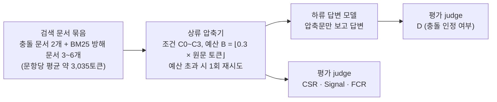
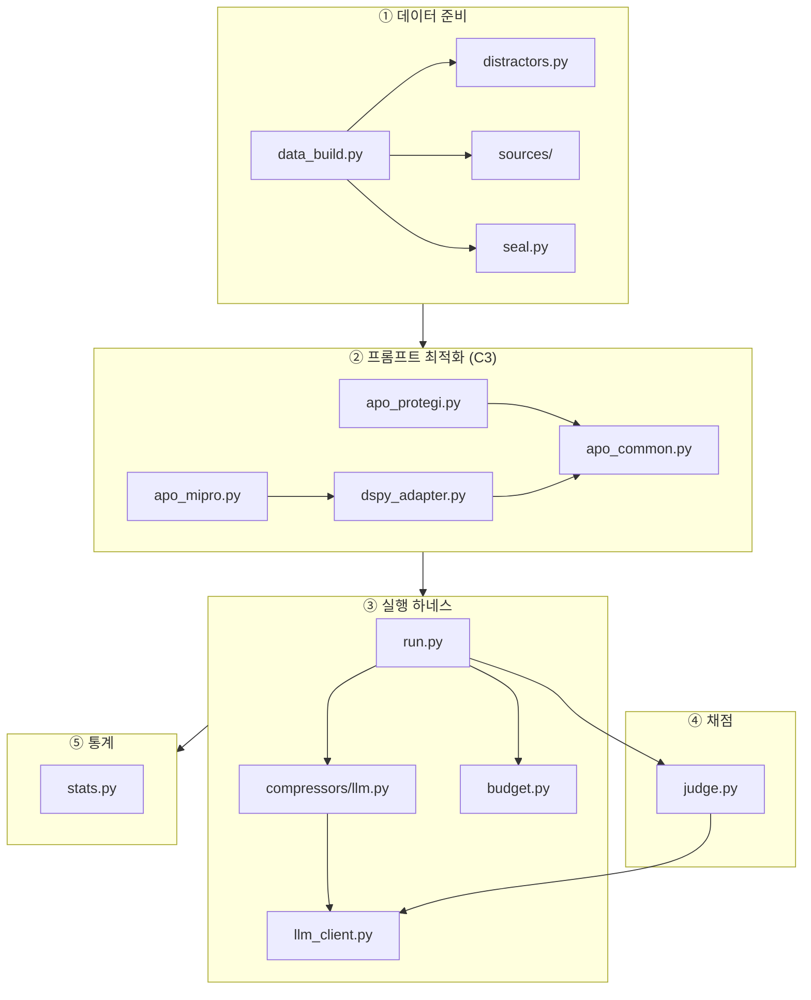
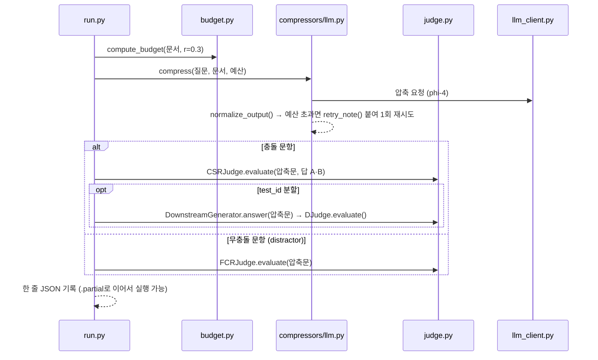

# rag-conflict-compression

**RAG에서 검색된 문서끼리 답이 충돌할 때, LLM이 문맥을 압축하는 단계에서 양쪽 답이 모두 살아남는지**를 측정하는 실험 코드와 결과입니다. 석사학위 논문을 위한 연구 코드이며, 아래 결과는 **예비 결과**입니다(seed 1개, 압축 비율 r = 0.3 한 가지만 사용했고, 이 압축기에 대해 평가 judge를 사람 라벨로 검증하기 전입니다).

---

## 목차

1. [연구 질문 한눈에 보기](#1-연구-질문-한눈에-보기)
2. [실험 파이프라인](#2-실험-파이프라인)
3. [저장소 구조](#3-저장소-구조)
4. [소스코드 구조 (src/)](#4-소스코드-구조-src)
5. [문항 하나가 처리되는 과정](#5-문항-하나가-처리되는-과정)
6. [설치와 실행](#6-설치와-실행)
7. [결과 파일 읽는 법](#7-결과-파일-읽는-법)
8. [예비 결과](#8-예비-결과)
9. [데이터 출처와 라이선스](#9-데이터-출처와-라이선스)

---

## 1. 연구 질문 한눈에 보기

RAG 시스템은 검색한 문서가 길면 앞단에서 문맥을 줄인 뒤(압축) 답변 모델에 넘깁니다. 그런데 검색된 문서끼리 같은 질문에 서로 다른 답을 내놓는 경우가 있습니다.

| 문서 | 내용(예시) |
|---|---|
| 문서 A | "Feinberg는 **Pomeranchuk Prize**를 받았다." |
| 문서 B | "Feinberg는 **Dobloug Prize**를 받았다." |

압축 과정에서 한쪽이 지워지면, 답변 모델은 문서가 충돌했다는 사실 자체를 알 수 없고 남은 한쪽을 정답처럼 말합니다. 이 저장소는 다음 질문에 답하려고 합니다.

> **압축 지시문을 어떻게 쓰느냐에 따라, 충돌하는 두 답이 압축 뒤에도 함께 남는 비율이 얼마나 달라지는가?**

### 비교하는 압축 조건 (독립변수)

| 조건 | 압축 지시문 | 프롬프트 파일 |
|---|---|---|
| **C0** | 질문에 필요한 정보만 남겨 압축 | `prompts/c0_naive.txt` |
| **C1** | C0 + "문서가 충돌하면 양쪽을 모두 남겨라" | `prompts/c1_plain.txt` |
| **C2** | 사람이 쓴 구조화 매뉴얼 + 고정 예시 3개 (v0, 튜닝 전) | `prompts/c2_best.txt`, `prompts/c2_fewshot.json` |
| **C3-P** | C2를 ProTeGi로 자동 최적화(예시는 고정) | `prompts/openrouter/c3p.txt` |
| **C3-M** | C2를 MIPROv2로 자동 최적화(예시는 고정) | `prompts/openrouter/c3m.txt` |

### 측정 지표 (종속변수)

| 지표 | 뜻 |
|---|---|
| **CSR** (주 지표) | 압축문에 답 A와 B가 모두, 왜곡 없이, 예산 안에서 남아 있는 비율 |
| **Signal** | 압축문이 충돌 사실을 명시적으로 표시한 비율 |
| **D** | 하류 답변 모델이 최종 답에서 충돌을 인정한 비율 |
| **FCR** | 충돌이 없는 문서에서 압축문이 가짜 충돌을 만들어 낸 비율 |

---

## 2. 실험 파이프라인



phi-4 실험에서는 모델 계열이 겹치지 않도록 역할마다 다른 회사의 모델을 배정했습니다(`configs/models_openrouter.yaml`). 모든 호출은 OpenRouter를 거칩니다.

| 역할 | 모델 | 계열 |
|---|---|---|
| 압축기, 하류 답변 모델 | `microsoft/phi-4` (14B) | Microsoft |
| 최적화용 judge | `meta-llama/llama-3.1-8b-instruct` | Meta |
| 최적화 반성(reflection) 모델 | `openai/gpt-4o-mini` | OpenAI |
| 평가 judge | `qwen/qwen-2.5-72b-instruct` | Alibaba |

---

## 3. 저장소 구조

### 핵심 파일 지도

처음 보는 분은 아래 파일부터 보시면 됩니다. 실험이 어떻게 돌아가는지는 `src/`의 다섯 파일에, 무엇이 나왔는지는 `results/openrouter_phi4_expanded/`에 있습니다.

```
rag-conflict-compression/
├── configs/
│   ├── models_openrouter.yaml       # 역할별 모델: phi-4(압축·하류 답변)와 계열이 다른 judge·반성 모델 3종
│   └── conditions_openrouter.yaml   # 조건 C0~C3-M → 지시문·예시 파일 경로
├── src/
│   ├── run.py                       # [핵심] 실험 러너: 문항마다 압축 → 채점 → 하류 답변 → 한 줄 기록
│   ├── judge.py                     # [핵심] LLM-as-a-Judge 채점기: CSR·FCR·D 판정
│   ├── apo_protegi.py               # [핵심] C3-P 지시문을 만든 ProTeGi 최적화
│   ├── apo_mipro.py                 # [핵심] C3-M 지시문을 만든 MIPROv2 최적화
│   └── stats.py                     # [핵심] 지표 집계와 가설 검정, 결과 보고서 생성
├── prompts/openrouter/
│   ├── c3p.txt                      # 최적화 결과 C3-P 지시문
│   └── c3m.txt                      # 최적화 결과 C3-M 지시문
├── reports/openrouter/
│   ├── apo_log_C3-P_seed0.json      # ProTeGi 실행 로그: 설정, 후보, 점수
│   ├── apo_log_C3-M_seed0.json      # MIPROv2 실행 로그: 설정, 시도, 점수
│   └── protegi_trace.jsonl          # ProTeGi 단계별 후보·검증 점수 기록
└── results/
    ├── openrouter_phi4_expanded/    # [핵심] 최종 결과: 1,354문항 × 5조건 = 6,770건
    │   ├── FINAL_BENCHMARK_REPORT.md   # 조건별 지표, 가설 검정 표
    │   ├── FROZEN_PROMPTS.json         # 실행에 쓴 프롬프트의 SHA-256
    │   └── <조건>_<분할>_r0.3_s0.jsonl  # 원자료 20개 (C0·C1·C2·C3-P·C3-M × 4개 분할)
    └── openrouter_phi4/             # 1차 실행: 554문항 × 5조건 = 2,770건 (구성은 위와 같음)
```

### 전체 구조

```
rag-conflict-compression/
├── README.md                ← 이 문서
├── LICENSE                  ← MIT
├── pyproject.toml, uv.lock  ← Python 3.12 환경 (uv로 설치)
├── .env.example             ← OPENROUTER_API_KEY 예시
│
├── src/                     ← 실험 코드 (4장에서 자세히 설명)
├── scripts/                 ← 실험 전체를 돌리는 실행 스크립트
├── configs/                 ← 모델 역할, 조건 → 프롬프트 파일 매핑
├── prompts/                 ← 압축·채점·하류 답변 프롬프트
├── tests/                   ← pytest 단위 테스트 (네트워크 없이 실행)
│
├── data/
│   ├── SEALED.md            ← 봉인한 테스트 데이터의 SHA-256 해시
│   └── processed/apo_split.json  ← 프롬프트 최적화에 쓴 train/val 문항 id
├── results/
│   ├── openrouter_phi4/          ← phi-4 1차 실행 (test_id 200, ood1 100, ood2 154, distractor 100)
│   └── openrouter_phi4_expanded/ ← phi-4 확장 실행 (test_id 600, ood1 300, ood2 154, distractor 300)
└── reports/openrouter/      ← 자동 최적화 로그 (ProTeGi, MIPROv2)
```

### `scripts/`: 무엇을 실행하나

| 파일 | 역할 |
|---|---|
| `env_openrouter.sh` | phi-4 실험용 환경변수 설정. 설정, 프롬프트, 결과, 캐시 폴더를 phi-4 전용으로 분리 |
| `run_openrouter_bench.sh` | 1차 실행. 조건 5개 × 분할 4개를 차례로 돌림. 비용 상한이 있고, 중단돼도 이어서 실행 가능 |
| `run_openrouter_expanded.py` | 확장 실행. 같은 동결 프롬프트로 아직 쓰지 않은 봉인 문항까지 평가(총 N = 1,354) |
| `run_lite.sh`, `run_detached.sh`, `lite_status.sh` | 이전 단계인 로컬 phi-3.5 예비 실험(G1-lite)의 단계별 실행·상태 확인 |

### `configs/`와 `prompts/`

| 파일 | 역할 |
|---|---|
| `configs/models_openrouter.yaml` | phi-4 실험의 역할 배정과 모델별 가격 |
| `configs/conditions_openrouter.yaml` | 조건 이름(C0~C3-M) → 지시문·예시 파일 경로 |
| `configs/models.yaml`, `configs/conditions.yaml` | 이전 로컬 실험(Ollama)용 설정 |
| `prompts/judge_csr.txt`, `judge_fcr.txt`, `judge_d.txt` | 평가 judge에게 주는 채점 기준 |
| `prompts/downstream.txt` | 하류 답변 모델 지시문 |
| `prompts/protegi_*.txt` | ProTeGi의 오류 분석·수정·바꿔쓰기 프롬프트 |
| `prompts/*_ko.md`, `*_대역본.md` | 프롬프트의 한국어 대역(참고용) |

---

## 4. 소스코드 구조 (`src/`)

`src/`의 모듈은 실험 단계에 따라 다섯 묶음으로 나뉩니다. `pyproject.toml`이 `src/`를 import 경로로 지정하므로, 모듈끼리는 `import run`처럼 바로 불러 씁니다.



### ① 데이터 준비

| 파일 | 하는 일 | 주요 함수·클래스 |
|---|---|---|
| `data_build.py` | 원본에서 문항을 고르고(길이 300~600토큰 등 필터), 방해 문서를 붙여 섞은 뒤 dev / test 분할을 만듦 | `build_conflictbank()`, `build_wikicontradict()`, `assemble()`, `build_all()` |
| `distractors.py` | 질문과 BM25 유사도가 높은 방해 문서 검색. 정답 문자열이 든 문서는 제외 | `DistractorPool.pick()` |
| `sources/conflictbank.py` | ConflictBank 원본(약 5.8GB JSONL)을 한 줄씩 읽는 로더. 바이트 위치 색인으로 다시 읽기 | `build_index()`, `read_record()` |
| `sources/wikicontradict.py` | WikiContradict CSV 로더·정제(OOD-2용) | `load_rows()`, `clean()` |
| `seal.py` | 테스트 분할을 SHA-256으로 봉인하고, 프롬프트를 동결하며, 테스트 데이터 접근을 기록 | `seal_files()`, `verify_sealed()`, `freeze_prompts()`, `check_test_access()` |
| `make_test_subset.py` | 봉인 풀에서 앞 N개 문항을 잘라 test_id 생성 | `make_test_id()` |

**봉인 규칙**: `run.py`가 테스트 분할을 읽기 전에 `check_test_access()`가 두 가지를 확인합니다. 하나는 데이터 해시가 `data/SEALED.md`와 같은지, 다른 하나는 프롬프트 해시가 `FROZEN_PROMPTS.json`과 같은지입니다. 둘 다 맞아야 열 수 있고, 모든 시도는 `test_access_log.jsonl`에 남습니다. 따라서 프롬프트를 확정하기 전에는 테스트 문항을 볼 수 없습니다.

### ② 프롬프트 자동 최적화 (C3)

| 파일 | 하는 일 | 주요 함수·클래스 |
|---|---|---|
| `apo_protegi.py` | **C3-P**. 틀린 문항의 원인을 자연어로 분석하고(“텍스트 그래디언트”), 지시문을 고친 뒤 UCB 밴딧으로 후보를 고름 | `run()`, `expand()`, `ucb_bandit()`, `Scorer`, `Reflector` |
| `apo_mipro.py` | **C3-M**. DSPy의 MIPROv2(베이지안 탐색)로 지시문 후보를 탐색 | `run_mipro()` |
| `apo_gepa.py` | C3-G. GEPA 최적화(이전 phi-3.5 예비 실험에서 사용) | `run_gepa()` |
| `apo_common.py` | 세 최적화기의 공통 부품: 학습/검증 분할, 점수 함수, 피드백 문장 | `build_apo_split()`, `judge_and_score()`, `describe_loss()`, `answer_kept()` |
| `dspy_adapter.py` | DSPy와 이 하네스를 연결. 모든 LM 호출이 `LLMClient`를 거치게 해서 비용과 캐시를 통제 | `ClientLM`, `BudgetedCompressor`, `HarnessAdapter`, `make_metric()` |
| `fewshot_check.py` | 최적화 중에 고정 예시가 바뀌지 않았는지 해시로 검사 | `check_log()` |
| `apo_variants.py`, `apo_estimate.py` | C3 변형 생성, 최적화 호출 수·비용 사전 추정 | `make_variant()`, `main()` |

### ③ 실행 하네스

| 파일 | 하는 일 | 주요 함수·클래스 |
|---|---|---|
| `run.py` | **실험의 진입점**. 조건 × 분할을 실행(`run`), 비용 추정(`estimate`), 프롬프트 동결(`freeze`) | `run_condition()`, `load_split()`, `build_compressor()`, `main()` |
| `compressors/llm.py` | C0~C3 공통 압축기. 지시문 파일만 바꿔 조건을 구분. 입력 조립, 출력 정리, 예산 초과 시 재시도 | `PromptCompressor.compress()`, `normalize_output()`, `retry_note()`, `render_examples()` |
| `budget.py` | cl100k 토큰 수 계산과 예산 B = ⌊r × 원문 토큰⌋ | `count_tokens()`, `compute_budget()`, `is_over_budget()` |
| `llm_client.py` | OpenRouter, Ollama, Splash 호출. 캐시, 비용 상한, 재시도, `mock`/`dry_run`/`execute` 세 가지 모드 | `LLMClient.call()`, `LLMClient.call_chat()`, `BudgetExceeded` |
| `mock_llm.py` | 네트워크 없이 결정론적으로 답하는 가짜 LLM(테스트용) | `respond()` |
| `configure_roles.py` | 역할별 모델을 배정하고, 같은 계열 모델이 겹치지 않는지 검사 | `assign_roles()`, `check_family_rule()` |

### ④ 채점

| 파일 | 하는 일 | 주요 클래스 |
|---|---|---|
| `judge.py` | 평가 judge 호출과 판정 해석 | `CSRJudge`: 압축문에서 A·B의 보존과 왜곡 판정 → CSR<br/>`FCRJudge`: 무충돌 문서에서 가짜 충돌 판정 → FCR<br/>`DownstreamGenerator`: 압축문만 보고 하류 답변 생성<br/>`DJudge`: 하류 답변을 DEFINITIVE / CONFLICT_ACK / INSUFFICIENT / OTHER로 분류 → D |
| `validate_judge.py` | judge 검증(G0): 재채점, 음성 대조, 저자 라벨 시트, 일치도 계산 | 하위 명령 `rejudge`, `negative-control`, `label-sheet`, `agreement`, `judge-checks` |
| `label_server.py`, `audit_server.py` | 사람이 블라인드로 라벨을 다는 로컬 웹 페이지 | `main()` |

### ⑤ 통계와 보조 도구

| 파일 | 하는 일 | 주요 함수 |
|---|---|---|
| `stats.py` | Wilson 신뢰구간, 짝 bootstrap, exact McNemar, Holm 보정, 정확 이항검정, Fisher 검정, κ. 결과 보고서 생성 | `lite_report()`, `mcnemar_exact_test()`, `paired_bootstrap()`, `holm()`, `binom_p()` |
| `preflight.py` | 무인 실행 전 점검(역할, 서버, 디스크, 봉인, 테스트) | `check_*()` |
| `pretest_gate.py` | 봉인을 열기 전 게이트(최적화 완료, 예시 고정, 출력 형식 등) | `run_gate()` |
| `pilot_select.py` | 압축기 후보 모델 비교(예비 단계) | `select_compressor()`, `run_h2h()` |
| `explore_compressor.py`, `generate_report.py` | 압축기 용량 탐색, 초기 파일럿 보고서(이전 단계) | `main()`, `build_report()` |

---

## 5. 문항 하나가 처리되는 과정

`run.py run`이 문항마다 거치는 순서입니다(`run.run_condition()`).



- 재시도 뒤에도 예산을 넘으면 judge를 부르지 않고 CSR = 0으로 처리합니다.
- 하류 답변 모델은 원문을 보지 못하고 압축문만 봅니다.
- 같은 문항, 같은 문서 순서를 모든 조건에 똑같이 쓰므로 조건끼리 짝 비교(McNemar)가 가능합니다.

---

## 6. 설치와 실행

### 설치

```bash
uv sync                    # Python 3.12, uv.lock 기준으로 설치
uv run pytest -q           # 단위 테스트(네트워크 없음)
cp .env.example .env       # 실제 호출 시 OPENROUTER_API_KEY 입력
```

`data/processed/dev.jsonl`이 필요한 테스트 3개는 데이터를 만들기 전까지 건너뜁니다.

### 데이터 다시 만들기

데이터셋은 이 저장소에 **재배포하지 않습니다.** 다음 순서로 직접 만들 수 있습니다.

1. Hugging Face `Warrieryes/CB_qa`의 `QA_dataset.json`을 `data/raw/conflictbank/`에 내려받습니다.
2. WikiContradict CSV를 `data/raw/wikicontradict_all.csv`에 두거나, 경로를 `CCD_WIKI_CSV` 환경변수로 지정합니다.
3. `uv run python src/data_build.py`를 실행합니다(seed 42로 결정론적).
4. 만들어진 `data/sealed/` 파일의 해시를 `data/SEALED.md`와 비교해 같은 데이터인지 확인합니다.

### phi-4 실험 실행

```bash
source scripts/env_openrouter.sh                   # phi-4 전용 설정·결과·캐시 경로
uv run python src/run.py freeze ...                # 프롬프트 해시 동결 (테스트 데이터를 열기 전 필수)
bash scripts/run_openrouter_bench.sh               # 1차 실행: 5조건 × 4분할
uv run python scripts/run_openrouter_expanded.py   # 확장 실행: N = 1,354
```

조건 하나만 돌리는 예시입니다.

```bash
uv run python src/run.py run --condition C1 --split test_id --r 0.3 --mode execute --max-cost 5
uv run python src/run.py estimate --conditions C0 C1 --splits dev --rs 0.3   # 호출 없이 비용만 추정
```

---

## 7. 결과 파일 읽는 법

파일 이름은 `<조건>_<분할>_r0.3_s0.jsonl` 형식이고, 한 줄이 문항 하나입니다.

| 분할 | 내용 |
|---|---|
| `test_id` | ConflictBank 오정보형 충돌(주 평가) |
| `test_ood1` | ConflictBank 시간형 충돌(일반화 평가 1) |
| `test_ood2` | WikiContradict 위키백과 실제 모순(일반화 평가 2) |
| `distractor` | 충돌이 없는 문서(가짜 충돌 FCR 측정) |

| 필드 | 뜻 |
|---|---|
| `question`, `gold.answer_a`, `gold.answer_b` | 질문, 답 A(원래 사실), 답 B(충돌하는 답) |
| `budget`, `out_tokens`, `over_budget`, `retried` | 예산, 출력 길이, 예산 초과 여부, 재시도 여부 |
| `compressed` | 압축문 |
| `judge.a_supported`, `judge.b_supported`, `judge.*_distorted` | A·B 보존 여부와 왜곡 여부 |
| `csr`, `signal` | 충돌 보존 성공(1/0), 충돌 표시 여부 |
| `false_conflict` | (distractor) 가짜 충돌 생성 여부 |
| `downstream.answer`, `downstream.category`, `downstream.D` | (test_id) 하류 답변, 분류, 충돌 인정 여부 |
| `prompt_sha256`, `meta` | 사용한 프롬프트 해시, 모델·호출 정보 |

각 결과 폴더에는 다음 파일도 함께 있습니다.

- `FINAL_BENCHMARK_REPORT.md`: 통계 보고서
- `FROZEN_PROMPTS.json`: 실행에 쓴 프롬프트 해시
- `test_access_log.jsonl`: 테스트 데이터 접근 기록
- `api_cost_log.jsonl`: 호출별 토큰과 비용

간단한 집계 예시입니다.

```bash
uv run python -c "import json; r=[json.loads(l) for l in open('results/openrouter_phi4_expanded/C1_test_id_r0.3_s0.jsonl')]; print(sum(x['csr'] for x in r), '/', len(r))"
```

---

## 8. 예비 결과

phi-4 확장 실행(test_id n = 600, r = 0.3, seed 0)의 결과입니다.

| 조건 | CSR | 95% 신뢰구간(Wilson) | D (하류 충돌 인정) |
|---|---|---|---|
| C0 | 30.0% (180/600) | 26.5–33.8 | 121/600 |
| C1 | 62.2% (373/600) | 58.2–66.0 | 305/600 |
| C2 | 83.2% (499/600) | 80.0–85.9 | 514/600 |
| C3-P | 84.7% (508/600) | 81.6–87.3 | 510/600 |
| C3-M | 87.0% (522/600) | 84.1–89.5 | 539/600 |

- **"둘 다 남겨라" 한 문장의 효과가 큽니다.** C1 − C0 = +32.2%p, exact McNemar p < 0.001입니다.
- **자동 최적화의 추가 이득은 작습니다.** C3-M − C2 = +3.8%p로, 보정 전 p = 0.013이고 Holm 보정 후 p = 0.053입니다. C3-P − C2 = +1.5%p로 유의하지 않습니다.
- **구조화된 지시문은 가짜 충돌도 많이 만듭니다.** 충돌이 없는 문서 300개에서 FCR은 C2 159건, C3-P 187건, C3-M 134건이었습니다. C0과 C1은 각각 1건이었습니다. FCR judge에는 정답을 함께 주었기 때문에 이 수치는 잠정치입니다.
- **WikiContradict(OOD-2)에서는 모든 조건의 보존율이 낮습니다.** 다만 이전 파일럿과 겹치는 문항이 45/154건이고 기사 단위로 몰려 있어서, 유의성은 주장하지 않습니다.

전체 표와 해석상 주의점은 `results/openrouter_phi4_expanded/FINAL_BENCHMARK_REPORT.md`에 있습니다.

### 이전 단계와의 관계

로컬 소형 모델(phi-3.5, 3.8B)로 한 예비 실험(G1-lite)에서는 C1이 C0보다 나았습니다(7.0% → 23.0%). 그러나 긴 지시문의 C2(3.0%)와 자동 최적화 지시문(2.0%)은 오히려 낮았습니다. 소형 모델이 예시의 형식만 따르고 질문과 무관한 내용을 충돌로 적었기 때문입니다. 이 결과가 지시문의 한계인지 모델 규모의 한계인지 구분하려고, 본 실험에서는 14B 모델(phi-4)을 사용했습니다. G1-lite 결과 파일은 이 저장소에 포함하지 않았습니다.

---

## 9. 데이터 출처와 라이선스

- **ConflictBank**: Su et al., *ConflictBank: A Benchmark for Evaluating the Influence of Knowledge Conflicts in LLM*, NeurIPS 2024 Datasets & Benchmarks. arXiv:2408.12076
- **WikiContradict**: Hou et al., *WikiContradict: A Benchmark for Evaluating LLMs on Real-World Knowledge Conflicts from Wikipedia*, NeurIPS 2024 Datasets & Benchmarks. arXiv:2406.13805

`results/`의 결과 파일에는 위 데이터셋에서 나온 질문, 답, 압축문이 들어 있습니다. 해당 내용은 원 데이터셋의 라이선스를 따릅니다.

코드는 MIT License로 공개합니다(`LICENSE` 참조).
